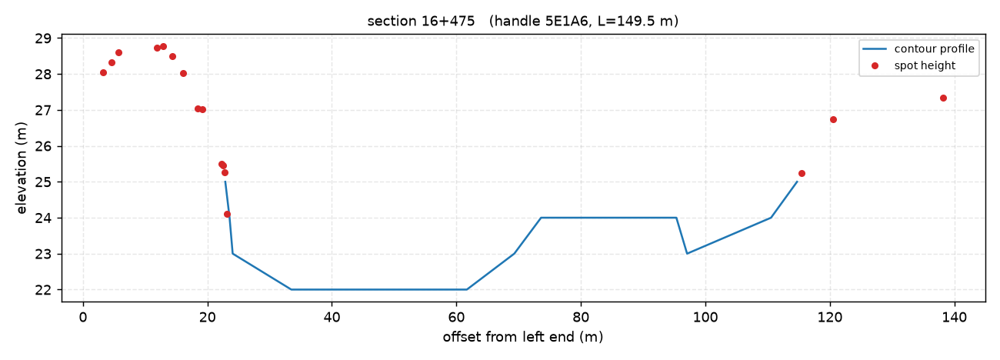
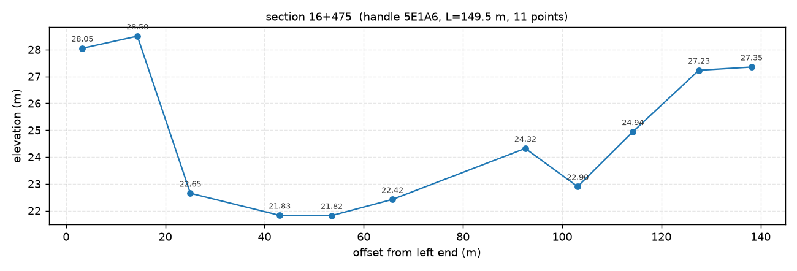
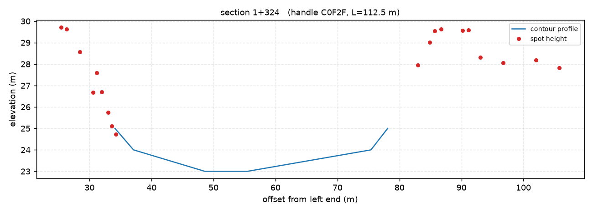
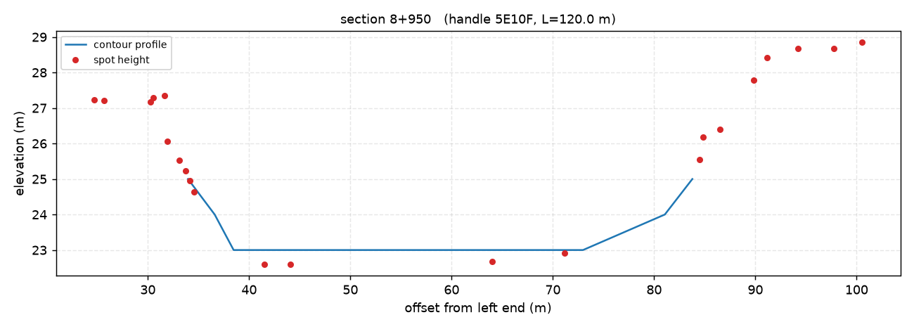

# M3-E6：大图几何快路径与 LISP 脚本纪律（教训固化）

> 起因：2026-11-04 用 `zwcad-cooperate` 处理用户真实图纸 `东总干渠1+300~16+500地形图20261020.dwg`
> （36,558 实体 / 17 图层 / 304 条断面线），目标是提取每条断面线的「起点距—高程」并出 Excel。
> 任务最终成功，但**耗时约 50 分钟**，其中真正取数只需 1–2 分钟。本文固化两条教训与待补能力。

## 一、实测对比：几何数据必须走 LISP 写文件，不要 COM 逐实体

| 路径 | 36,558 实体耗时 | 说明 |
|---|---|---|
| COM 逐实体（`foreach ModelSpace` + 读属性） | **310 s** | 每条记录 2–4 次 COM 属性访问；36 k 实体不可接受 |
| LISP `(ssget "X")` + `entget` + `write-line` 到 `%TEMP%` | **0.36 s** | 本文档 E5 的 lisp-file 通道，含 `__DONE__` 哨兵 |

**结论**：差 800 倍。只要任务是"要几何"，就必须一次性 dump 全部（含 `assoc 10/11/38` 与顶点），
而不是按实体 COM 读。

## 二、现状缺口（本次任务踩到）

`read`/`query` 的 lisp-file 快路径（E5 实现）当前只回传：

```
handle | type | layer | text
```

**不含坐标/顶点**，也没有等高线折线的 `Elevation` 属性（`assoc 38`）。因此本次任务被迫退回 COM 全扫 5 分钟。

### 待补（M3-E6 交付项）

1. **几何 dump 快路径**：`read -Mode geom` 在大图（实体数 > 阈值且无 LISP 变量桥）上改走 LISP：
   - 每实体一行 `E|handle|type|layer|text|x|y|z|nverts`
   - 多段线每顶点一行 `V|handle|i|x|y|z`
   - 折线（LWPOLYLINE/2D POLYLINE）额外输出 `ELEV|<handle>|<assoc-38 高程>`
   - 顶部可选只 dump 指定图层/类型（`ssget` 过滤），避免无关数据
2. **LISP 文件生成器**（helper 内部）：不再手写 .lsp，模板化生成 + 自动校验：
   - 强制 **ASCII、无 BOM**（带 BOM → `Error: 输入的列表有缺陷`）
   - **括号配平校验**（不平衡时先报错再注入，不要等 CAD 回 `Error: 语法错误`）
   - 路径统一 `/`、落 `%TEMP%`、结果 + `__DONE__` 哨兵
   - `CMDECHO` 保存/设 0/恢复，避免刷屏
3. **文档**：SKILL.md 的「铁律」与「能力边界」已写入（见 §三）。

## 三、已写入 SKILL.md 的条目（本次）

- 铁律 11：不要手写 LISP 探针（ASCII 无 BOM、括号配平、哨兵轮询、先最小骨架）
- 铁律 12：大图取几何不要 COM 全扫（36 k ≈ 5 min vs LISP 0.4 s），并标注 lisp-file 快路径缺坐标
- 能力边界新增行：大图几何快路径（坐标/顶点/Elevation 待补）
- 性能基线下方补实测对比与 `build_sections_from_dmx.py` 参考

## 四、断面提取的产出与口径（本次交付，供复用）

- 脚本：`scripts\section\build_sections_from_dmx.py`
- 输入：`%TEMP%\zwcad-cooperate\geom-com.json`（实体几何）+ `contours.json`（等高线 + Elevation）
- 识别规则：断面线 = `dmx` 层直线；桩号 = `KZD` 层 `\d+\+\d+` 文字（8 m 内 1:1 匹配）；高程点 = `ZDH` 层 POINT 的 Z（≠0）；补点 = `DGX` 等高线与断面线求交
- 起点距：面朝下游（桩号增大方向）的**左岸为 0**
- 实测：304 条断面、6,647 个高程点 + 2,803 个等高线交点 = 9,450 个剖面点；同图重跑 10 s
- 注意：9 条断面高程点 <10 个（局部缺测点），精度依赖等高线

### 4.1 效果校验图（两条高程来源的对照）

同一条断面用两种高程来源各算一遍，叠在一起看差异，是这套脚本唯一有效的"肉眼验收"手段：

- **等高线求交**（`build_sections_from_dmx.py`，蓝线 `contour profile`）—— 断面线与 `DGX` 层等高线求交补点，剖面连续但会把等高线的阶梯感带进来；
- **高程点块 Z**（`build_sections_gcd.py`，红点 `spot height`）—— 直接取 `ZDH` 层 POINT 的 Z，点位真实但疏密不均、局部缺测。






> 读图要点：蓝线在岸坡段明显比红点"低/高半格"是等高线求交的固有偏差（等高距 1 m 内插），
> 河槽平坦段两者一致（16+475 的 22.0 m 平台）；红点在中段缺测时蓝线只能靠等高线撑住，这正是
> "高程点 <10 个的 9 条断面精度依赖等高线"的直观来源。图由 `tmp\sections\analyze*.py` 系列
> 脚本用 matplotlib 生成（仅离线分析用，不属仓库运行时依赖）。

## 五、实现（M3-E6）

| 组件 | 内容 |
|---|---|
| `scripts/helper/LispTemplate.cs` | **生成器**：`BuildDump(geom, txt, done, ssFilter)` 生成纯 ASCII 脚本；`WriteScript()` 依次过 **ASCII 校验 → 括号配平（忽略字符串/注释）→ 只读安全白名单**，任一不过抛 `LISP_TEMPLATE_NOT_ASCII` / `LISP_TEMPLATE_UNBALANCED` / `LISP_TEMPLATE_UNSAFE` 且**不注入**；`CMDECHO` 保存/设 0/恢复；哨兵 `__DONE__|<n>`。全脚本只用基础 AutoLISP（无 `vl-*`，2D 点缺 Z 用 nil-safe 补 0.0）。 |
| `scripts/helper/LispGeom.cs` | **几何 dump 通道**：`E/V/P2/ELEV/H/CL` 行解析 → 实体 map（x/y/z、point、p2、vertices/points、elevation、height、closed），GBK936 解码，失败抛错由 read 回退；生成同样的 `meta{lispInjectMs,lispSentinelMs,parseMs,totalMs,fileBytes,decodedAs}`。 |
| `ZwcHelper.Read` | `-Mode geom` 在"无 LISP 桥 + 实体数 > `-LispThreshold`（默认 2000）"时自动走 LispGeom，响应 `readPath:"lisp-file-geom"`；失败回退 COM + `LISP_GEOM_FALLBACK`（对 geom 而言 COM 很慢，故仅在 LISP 不可用时发生）。 |
| `lispgen` debug 命令 | 不 attach CAD，只生成 `.lsp` 到文件并回 `{path,bytes,ascii,balance}`，供测试/审查（本轮用它验证生成器）。 |
| `Queries` | E5 的 `query` 也改为调用同一生成器（ASCII/括号/安全校验），`-Type` 仍下推 ssget。 |

### 5.1 只读安全约束（SelectionSet.Delete 事故后新增，硬约束）

1. **禁止 `SelectionSets` 相关 API**（尤其 `SelectionSet.Delete()`）；按层筛选只用 LISP `(ssget "X" (list (cons 8 layer)))`。
2. **LISP 模板只读白名单**：`ssget/entget/assoc/princ/write-line/open/close/itoa/rtos/getvar/strcat/strlen/substr/chr/nth/car/cdr/cons/list/length/reverse/foreach/while/if/progn/setq/…`；**禁止** `command/entdel/entmod/entmake/entmakex/erase/Delete/SelectionSets/vla-/vlax-/vlr-/vl-load/undo/_.U/saveas/qsave/-layer/-insert/…`。生成器在 `WriteScript()` 里逐 token 校验（忽略字符串/注释），命中即报 `LISP_TEMPLATE_UNSAFE`。
3. `setvar` **只允许 CMDECHO**（保存/设 0/恢复），其他 setvar 一律拒绝。
4. **用户正在编辑的图纸 = 只读，任何注入先征得用户/lead 同意**；自测一律在自己的 `open -Launch` 自动化实例/夹具图上做。

### 5.2 实测（小筛选验证，用户真实图，只读）

| 测试 | 结果 |
|---|---|
| 生成脚本 | `lispgen -Geom` → 3,396 B，`ascii:true`，`balance:null`，通过安全门 |
| `(ssget "X" '((0 . "LINE,LWPOLYLINE")))` 手动注入 | **2,995 条记录 / 334 ms**，E/P2 行坐标正确（例：`E|1079A6|LINE|JMD||420218.215874|3124393.412191|0` + `V|…` + `P2|…`），`CMDECHO` 恢复 1 |
| `(ssget "X" '((0 . "LINE")))` | **1,500 条 / 237 ms**，E/V/P2 各 1,500 行 |
| `(ssget "X" '((0 . "CIRCLE")))` | 0 条（该图无圆）→ 哨兵 `__DONE__|0`，脚本正常结束 |
| 全量 36,558 `read -Mode geom` | **未完成**：生成器早期版本有缺陷（2D 点 Z 为 nil、vl-string-translate 不可用）导致 LISP 报错、两次注入超时（helper 之一回退 one-shot 后 180 s 超时）；修复后仅用上述小筛选验证语法/逻辑。→ **2026-11-05 已复测，见 §六**。 |

> 注：全量 dump 期间用户图纸 `CMDECHO` 一度被我方脚本设为 0（脚本未走到恢复行），随后已 `(setvar "CMDECHO" 1)` 恢复；未做任何改图操作。

## 六、2026-11-05 复测与修复（解析正确性 + 注入治理）

> 图纸换成用户当天打开的 `东总干渠16+500~24+700地形图.dwg`（41,413 实体 / 2 个文档），改动前基线 `tmp\baseline2\*` 与改动后逐字段 A/B，全部显式 `-Doc`、只读。真机窗口由 lead 统一调度（一个 agent 独占，避免并发注入互踩 CMDECHO/命令态）。

### 6.1 两个静默错数据的缺陷已修

| 缺陷 | 根因 | 修法 | 验证 |
|---|---|---|---|
| 含 `\|` 的文字把几何字段打歪 | `LispTemplate` 把文字里的 `\|` 转义成 `\\\|`；`LispFile.SplitRecord` 认这个转义，但 `LispGeom.Scan` 用**裸 `Split('|')`** ⇒ 行内字段整体右移，`x/y/z/nverts` 落到文本片段上被 `Num()` 解析成 `0.0`（**坐标静默变 0、顶点错挂**） | 抽出 `scripts\helper\LispWire.cs`（BCL-only，零依赖）：`SplitRecord/UnescapeField/TryNum/ParseGeometry/ParseFlat` 成为**唯一解析实现**，两个 Scan 只留「管道 + `LispRecord`→`JMap` 映射」 | 离线 `tests\lispwire` 99 条断言（含 `E\|1A\|TEXT\|0\|A\\\|B\|1.5\|2.5\|0\|0` ⇒ 9 段 / Text=`A|B` / X=1.5）；真机 A/B 500/500 实体整表逐字段相等 |
| CIRCLE/ARC 的 `radius` 丢失 | 模板写 `R|handle|radius`，但 `LispFile.IsAuxRecord` 把它当忽略项、`LispGeom` 无对应分支 ⇒ 同一张图走 LISP 与走 COM 字段不一致 | `LispWire` 解析 `R` 记录写入 `Radius`，映射到 `radius`（与 COM 路径对齐）；`LispFile` 仍忽略但改由 `LispWire.IsAuxKind` 统一判定 | 离线断言 `R|h|2.5` ⇒ `radius=2.5`；样本图前 500 实体无 CIRCLE/ARC，**真机侧本轮无法观测**（已记入能力边界） |

### 6.2 注入治理（P1-4.1，对应 M3-E6 §5.2 那次真实 CMDECHO 事故）

- **`*error*` 处理器**：脚本开头保存旧 `*error*`，安装「关文件 + 还原 CMDECHO + 还原旧 `*error*`」的处理器；正常收尾也还原。`SafetyError` 白名单为此新增 `defun`，但**跳过形参表**、`forbidden` 表与只读语义不变（`defun` 体内出现 `command` 仍被拒，有离线负例）。
- **两阶段哨兵**：脚本**先写 `__START__`**（独立 `.start` 文件）再做重活；超时后区分「注入未执行」（无 `__START__` ⇒ 新错误码 `LISP_NOT_STARTED`，提示查 CAD 忙/模态框/命令态）与「执行中卡死」（`LISP_FILE_TIMEOUT`，`error.detail` 带 `phase=started|not-started`）。
- **超时不再删正在写的文件**：失败/超时把 `.lsp/.start/.txt/.done` 改名 `*.orphan` 留证（CAD 可能还在写），每次扫描开头清理 **>24 h** 的 `*.orphan` 与遗留 `scan-*/geom-*`（失败静默）。
- 真机证据（2026-11-05）：`CMDECHO` 全量 read 前后均 **1**；成功路径 `%TEMP%\zwcad-cooperate` 中 `geom-*/scan-*` 计数 **0**；`FileSystemWatcher` 抓到 `geom-f7a56e0a3ce4.start 01:12:05.953 → .done 01:12:07.403`（另一次 01:14:20.308 → 01:14:21.741），即 `__START__` 先于 `__DONE__`；预置 mtime=25h 的 `geom-*.txt` 与 `.orphan` 均被清、mtime=now 的 `.orphan` 保留（24 h 宽限）。超时分支因 **Read 失败会 `LISP_FILE_FALLBACK` 回退 COM 全扫（41k≈10 min）**，按代价权衡改为**纯函数离线单测**（`LispOrphans`/`LispSentinelPhase` 21 条断言），不做端到端触发。

### 6.3 已知限制（本轮实测确认，协议未变）

**单次 `read -Mode geom` 的响应体过大时无法返回**：全量 41,413 实体时，LISP 通道本身**只有 ≈1.45 s**（dump 文件 4,801,512 B，与改动前基线**逐字节相同**）、扫描完全成功并自清理，但「41k 实体 → JSON 响应」这一步产生不出应答：
- 经 `ZwcClient`：客户端 180 s 超时被杀，**stdout 0 字节**；
- 绕开 client/管道直连 one-shot helper：进程 237,512 ms 后退出，**未写出 response 文件**，stdout/stderr 均空。
- 该失败形态在改动前就存在（`tmp\evidence-e6\geom-36558.json`，2026-11-04，同形 `TIMEOUT`），与本次改动无关。
- **可用做法**：`-Limit` 分页（实测最大成功档 `-Limit 500` = 152,422 B JSON，其背后的 dump 仍是全量 41,413 实体）；或直接消费 `%TEMP%` 里的 dump 文件（`build_sections_*.py` 走的就是这条）。
